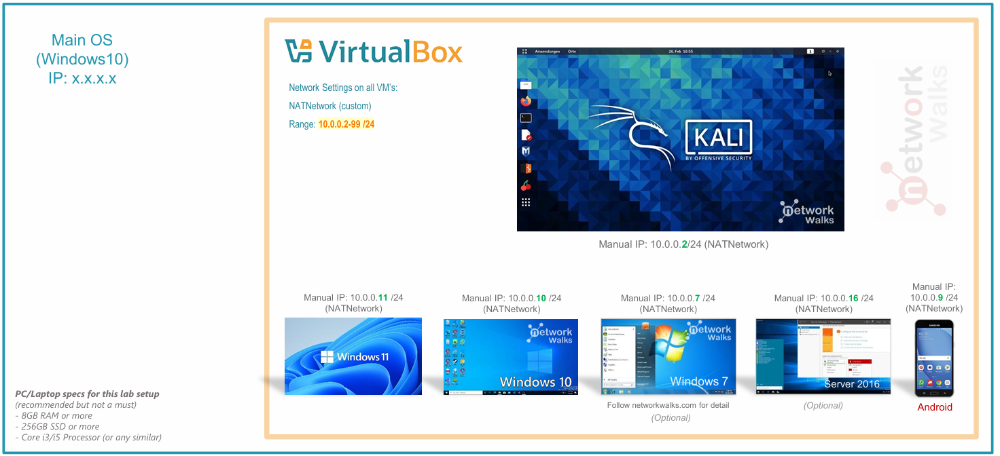
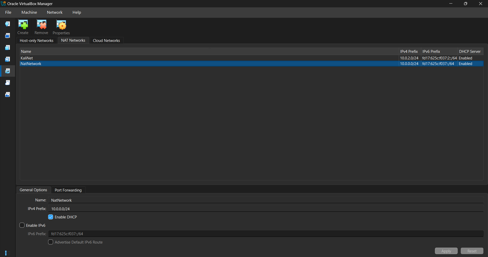
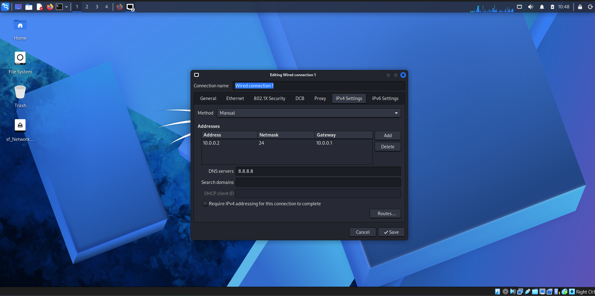
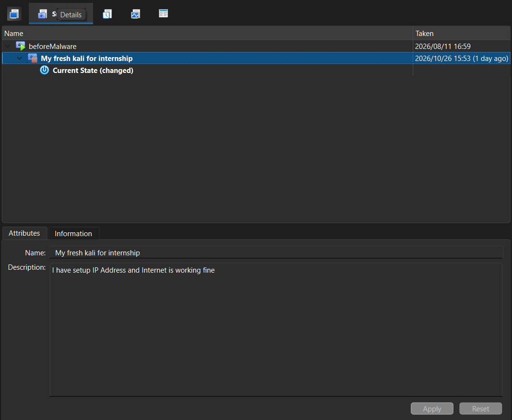
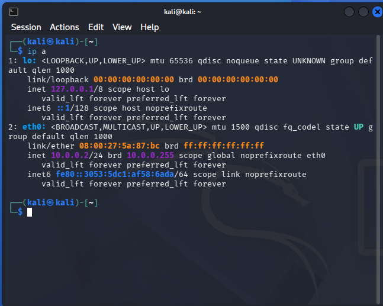
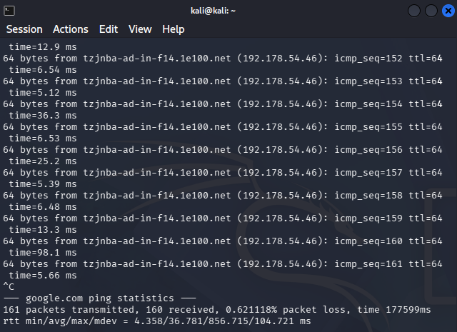
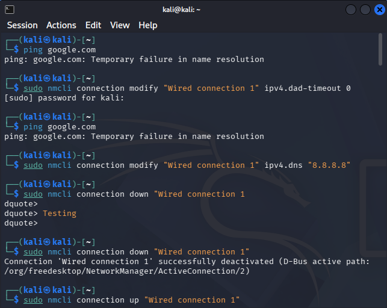

# NETWORKWALKS-LEHLOHONOLO-B084A-WK1-PM1-CYBERSECURITY-LAB-SETUP
Isolated virtual lab built with VirtualBox and Kali Linux for cybersecurity testing and penetration testing practice.

# 🔐 Cybersecurity Lab Environment Setup

**Building an isolated virtual lab for penetration testing and ethical hacking practice**

* * *

## 📌 Project Overview

This project focuses on setting up a **virtual cybersecurity and penetration-testing laboratory** using VirtualBox and Kali Linux.

The purpose of the lab is to create a controlled environment where cybersecurity tools, network scanning, reconnaissance, vulnerability assessment, and other security-testing activities can be performed safely and repeatedly.

The lab is configured on a private virtual network so that additional machines can be added later and used as targets for authorized security testing.

* * *

## 🎯 Objectives

The main objectives of this project are to:

  * Install and configure VirtualBox.
  * Install/import Kali Linux as a virtual machine.
  * Create a private **NAT Network** for the cybersecurity lab.
  * Configure network connectivity for Kali Linux.
  * Assign a consistent IP address to the Kali VM.
  * Verify network connectivity and DNS resolution.
  * Take a clean VM snapshot for recovery.
  * Document the complete setup process.
  * Prepare the environment for future cybersecurity projects.

* * *

## 🛡️ Purpose of the Lab

The lab provides an isolated and controlled environment for cybersecurity learning and authorized security testing.

It can be used for activities such as:

  * Network reconnaissance
  * Port scanning
  * Vulnerability assessment
  * Packet analysis
  * Web security testing
  * Exploitation practice
  * Security-tool experimentation

⚠️ **Important:** This laboratory must only be used for systems that you own or have explicit permission to test. Do not use the lab or its tools to attack unauthorized systems.

* * *

## ⚙️ Lab Configuration

🧩 Component | ⚙️ Configuration  
---|---  
🖥️ Host OS | Windows 11
🧠 Host RAM | 8 GB 
⚡ Processor | Intel(R) Celeron(R) N4020 CPU @ 1.10GHz (1.10 GHz) 
🧰 Hypervisor | VirtualBox 7.2  
🐉 Security OS | Kali Linux 2026.2  
🧠 Kali RAM | 2048 MB  
🌐 Virtual Network | NAT Network  
📡 Network Address | 10.0.0.0/24  
🐧 Kali IP Address | 10.0.0.2/24  
🚪 Default Gateway | 10.0.0.1  
🌍 DNS Server | 8.8.8.8  
🔮 Future VM Range | 10.0.0.3–10.0.0.99  

* * *

# 🪜 Lab Setup Procedure

## Step 1. Install 7-Zip
7-Zip was installed to extract the Kali Linux virtual-machine package.

## Step 2. Install VirtualBox
VirtualBox was installed as the hypervisor.

## Step 3. Create the NAT Network
A dedicated NAT Network was created in VirtualBox.
Configuration: Network Name: NatNetwork, IPv4 Prefix: 10.0.0.0/24, DHCP: Enabled, IPv6: Disabled.

## Step 4. Import Kali Linux
The Kali Linux virtual machine was downloaded from the official Kali Linux website and imported into VirtualBox.

The VM network adapter was configured as follows:
    Adapter 1
    Attached to: NAT Network
    Network:     NatNetwork
    Adapter Type: Intel PRO/1000 MT Desktop

The VM was allocated 2048 MB of RAM. A shared folder was also configured for transferring required files between the host operating system and the Kali VM, and bidirectional clipboard was enabled.

## Step 5. Configure the Kali Linux Network
The Kali Linux network configuration was checked and configured with a consistent IPv4 address.

Example configuration:
    IP Address: 10.0.0.2
    Subnet Mask: 255.255.255.0
    Gateway: 10.0.0.1
    DNS: 8.8.8.8

## Step 6. Create a Clean VM Snapshot
After completing the initial configuration, a VirtualBox snapshot was created named: `My fresh kali for internship`. The snapshot represents the clean baseline of the laboratory.

* * *

# 🔎 Lab Verification

✅ Test | 🧾 Command | 🎯 Expected Result  
---|---|---  
🌐 Check IP address | `ip a` | Correct Kali IP displayed  
📡 Test gateway | `ping 10.0.0.1` | Successful replies  
🌍 Test Internet connectivity | `ping 8.8.8.8` | Successful replies  
🔎 Test DNS resolution | `ping google.com` | Domain resolves  

* * *

# 🐞 Problems Encountered & Solutions

Documenting problems is an important part of the project.

## Problem 1. Internet Connectivity / DNS Failure After Static IP Configuration
**Issue:** After manually configuring the IPv4 settings and running the standard `dad-timeout` command, Kali Linux lost internet connectivity and failed DNS resolution (`Temporary failure in name resolution`). 

**Solution:** I used the `nmcli` command-line tool to manually set the DNS server to Google's public DNS and reset the connection.

Commands used:
    sudo nmcli connection modify "Wired connection 1" ipv4.dns "8.8.8.8 1.1.1.1"
    sudo nmcli connection modify "Wired connection 1" ipv4.dad-timeout 0
    sudo nmcli connection down "Wired connection 1"
    sudo nmcli connection up "Wired connection 1"

After restarting the network interface, internet access and DNS resolution were fully restored.

* * *

# 💡 What I Learned

Through this project, I learned how to create and configure a virtual environment for cybersecurity practice.

### 1. NAT vs NAT Network
I learned that a NAT Network allows multiple VMs to communicate with one another while providing external connectivity, which is essential for future multi-machine labs. While with NAT multiple VMs cannot communicate with each other because they cannot see each other, each machine has it's isolated connection.

### 2. Virtual Machine Networking
I learned how VirtualBox virtual network adapters connect to different types of networks.

### 3. Static IP Configuration
I learned how to configure and verify IPv4 addressing and DNS settings in Kali Linux.

### 4. Troubleshooting
I gained hands-on experience troubleshooting Linux network manager (`nmcli`) issues and DNS resolution failures. 

### 5. Documentation
I learned that documenting commands, screenshots, and solutions is a vital professional skill.

* * *

* * *

# 🔗 Tools & Resources

  * **7-Zip:** https://7-zip.org/download.html
  * **VirtualBox:** https://virtualbox.org/wiki/Downloads
  * **Kali Linux:** https://kali.org/get-kali

* * *

# 👤 Author

**Lehlohonolo Mabesele**  
Cybersecurity Intern B084A  
www.linkedin.com/in/lehlohonolo-mabesele-905a8b35a

* * *

## 📌 Project Information

**Program Name:** Cybersecurity at Networkwalks | **Week:** 01 | **Project:** Cybersecurity & Pentesting Lab Setup
